<picture><source media="(prefers-color-scheme: dark)" srcset="assets/hero-dark.svg"></picture>
  
<a href="https://abhijeet-dash.vercel.app"><picture><source media="(prefers-color-scheme: dark)" srcset="assets/btn-portfolio-dark.svg"></picture></a>&nbsp;<a href="https://github.com/Abhijeet-Dashy"><picture><source media="(prefers-color-scheme: dark)" srcset="assets/btn-github-dark.svg"></picture></a>&nbsp;<a href="https://linkedin.com/in/abhijeet-dashy"><picture><source media="(prefers-color-scheme: dark)" srcset="assets/btn-linkedin-dark.svg"></picture></a>&nbsp;<a href="mailto:dashabhijeet05@gmail.com"><picture><source media="(prefers-color-scheme: dark)" srcset="assets/btn-email-dark.svg"></picture></a>
  
<picture><source media="(prefers-color-scheme: dark)" srcset="assets/divider-dark.svg"></picture>
<picture><source media="(prefers-color-scheme: dark)" srcset="assets/h-about-dark.svg"></picture>
 
<picture><source media="(prefers-color-scheme: dark)" srcset="assets/about-1-dark.svg"></picture>&nbsp;<picture><source media="(prefers-color-scheme: dark)" srcset="assets/about-2-dark.svg"></picture>
<picture><source media="(prefers-color-scheme: dark)" srcset="assets/about-3-dark.svg"></picture>&nbsp;<picture><source media="(prefers-color-scheme: dark)" srcset="assets/about-4-dark.svg"></picture>
 
<picture><source media="(prefers-color-scheme: dark)" srcset="assets/divider-dark.svg"></picture>
<picture><source media="(prefers-color-scheme: dark)" srcset="assets/h-toolbox-dark.svg"></picture>
 
<picture><source media="(prefers-color-scheme: dark)" srcset="assets/toolbox-frontend-dark.svg"></picture>&nbsp;<picture><source media="(prefers-color-scheme: dark)" srcset="assets/toolbox-backend-dark.svg"></picture>&nbsp;<picture><source media="(prefers-color-scheme: dark)" srcset="assets/toolbox-tools-dark.svg"></picture>
 
<picture><source media="(prefers-color-scheme: dark)" srcset="assets/divider-dark.svg"></picture>
<picture><source media="(prefers-color-scheme: dark)" srcset="assets/h-activity-dark.svg"></picture>
 
<picture><source media="(prefers-color-scheme: dark)" srcset="https://raw.githubusercontent.com/Abhijeet-Dashy/Abhijeet-Dashy/output/stat-total-dark.svg"></picture>&nbsp;<picture><source media="(prefers-color-scheme: dark)" srcset="https://raw.githubusercontent.com/Abhijeet-Dashy/Abhijeet-Dashy/output/stat-current-dark.svg"></picture>&nbsp;<picture><source media="(prefers-color-scheme: dark)" srcset="https://raw.githubusercontent.com/Abhijeet-Dashy/Abhijeet-Dashy/output/stat-longest-dark.svg"></picture>
 
<picture><source media="(prefers-color-scheme: dark)" srcset="https://raw.githubusercontent.com/Abhijeet-Dashy/Abhijeet-Dashy/output/snake-dark.svg"></picture>
  
<picture><source media="(prefers-color-scheme: dark)" srcset="assets/footer-dark.svg"></picture>

